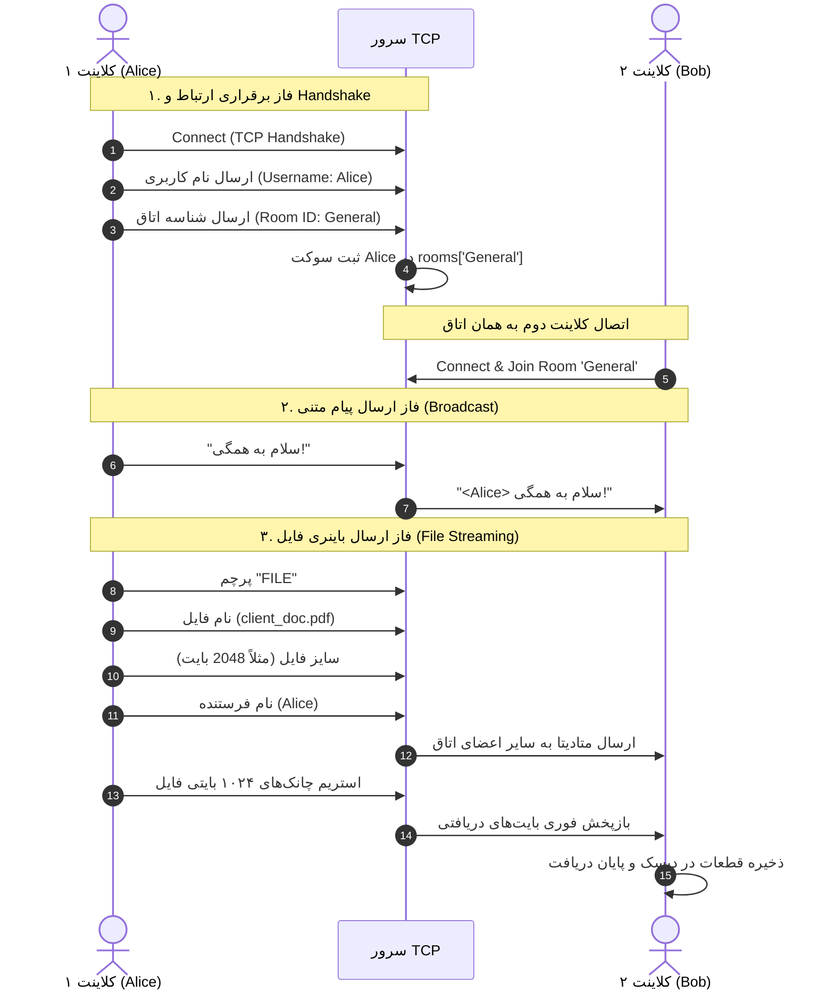

# 💬 برنامه چت و انتقال فایل تحت شبکه (Socket Chat Application)

یک پیام‌رسان دسکتاپ بلادرنگ و چندکاربره مبتنی بر معماری **Client-Server** که با استفاده از سوکت‌های **TCP** (`socket`) و رابط گرافیکی **Tkinter** در زبان پایتون طراحی و توسعه داده شده است. این سامانه از اتاق‌های گفتگوی ایزوله (Room-based Chat)، ارسال فایل باینری قطعه‌بندی‌شده (Chunked File Transfer) و مدیریت همزمان کلاینت‌ها با چندنخی (Multi-Threading) پشتیبانی می‌کند.

---

## 📌 فهرست مطالب
- [تصاویر محیط برنامه (Screenshots)](#-تصاویر-محیط-برنامه-screenshots)
- [قابلیت‌های کلیدی](#-قابلیت‌های-کلیدی)
- [تکنولوژی‌های استفاده‌شده](#-تکنولوژی‌های-استفاده‌شده)
- [درخت ساختار فایل‌های پروژه (Tree Structure)](#-درخت-ساختار-فایل‌های-پروژه-tree-structure)
- [حساب‌های کاربری پیش‌فرض جهت تست](#-حساب‌های-کاربری-پیش‌فرض-جهت-تست)
- [راهنمای نصب و اجرای لوکال](#-راهنمای-نصب-و-اجرای-لوکال)
  - [روش اول: اجرای سریع با اسکریپت‌ها](#روش-اول-اجرای-سریع-با-اسکریپت‌ها)
  - [روش دوم: اجرای دستی با خط فرمان](#روش-دوم-اجرای-دستی-با-خط-فرمان)
- [معماری و پروتکل انتقال اطلاعات](#-معماری-و-پروتکل-انتقال-اطلاعات)
- [رفع خطاهای رایج](#-رفع-خطاهای-رایج)

---

## 🖼 تصاویر محیط برنامه (Screenshots)

| ورود به سرور با پورت‌های مجزا (Multi-Port Login) | چت همزمان روی پورت‌های مختلف (Multi-Port Chat) |
| :---: | :---: |
|  |  |
| **ورود به اتاق‌های مجزا با پورت یکسان (Same Port Login)** | **ایزولاسیون و گفتگوی اتاق‌ها (Isolated Room Chats)** |
|  |  |

---

## ✨ قابلیت‌های کلیدی

- **سیستم اتاق‌های گفتگوی پویا (Dynamic Room-based Chat):** امکان ورود به اتاق‌های مجزا بر اساس `Room ID`. در صورت عدم وجود اتاق، سرور آن را به شکل خودکار ایجاد کرده و کاربران اتاق‌های دیگر به پیام‌ها دسترسی نخواهند داشت.
- **ارسال پیام بلادرنگ (Real-Time Broadcasting):** بازپخش سریع پیام‌های متنی ارسالی برای تمام کلاینت‌های متصل به همان اتاق به صورت دوطرفه (Full-Duplex).
- **انتقال امن فایل (Chunked Binary File Transfer):** اشتراک‌گذاری هر نوع فایل (تصویر، متن، اسناد) با قطعه‌بندی داده‌ها در بافرهای ۱۰۲۴ بایتی و ذخیره در کلاینت مقصد با پیشوند `client_`.
- **معماری چندنخی کامل (Multi-Threading):**
  - **سمت سرور (`_thread`):** اختصاص یک Thread جداگانه به هر کلاینت، بدون معطل شدن سرور برای سایر کاربران.
  - **سمت کلاینت (`threading.Thread`):** تفکیک حلقه دریافت پیام از حلقه رندر UI جهت جلوگیری از فریز شدن پنجره گرافیکی.
- **رابط کاربری سفارشی و مدرن (Tkinter GUI):** طراحی اختصاصی با پالت رنگی گرم (زرشکی، طلایی، کرم و قهوه‌ای)، دکمه‌های کنترلی، نوارهای اسکرول، فیلدهای ورودی پویا و پنجره‌های پیام خطای اختصاصی.
- **پیکربندی منعطف پورت و آی‌پی:** قابلیت تعیین پورت سرور هنگام راه‌اندازی (خط فرمان یا دیفالت `12345`) و امکان اتصال کلاینت‌ها به پورت‌های متفاوت.

---

## 🛠 تکنولوژی‌های استفاده‌شده

- **زبان برنامه‌نویسی:** Python (نسخه 3.8 به بالا - تست‌شده و توسعه‌یافته با Python 3.10)
- **ماژول سوکت شبکه (`socket`):** پیاده‌سازی اتصالات TCP/IP، تعریف بافرها و مدیریت پروتکل انتقال باینری و متنی.
- **رابط گرافیکی (`tkinter`):** پیاده‌سازی GUI چندپنجره‌ای، فرم‌های لاگین، کادرهای متنی، استایل‌بندی و ابزارک‌های تعاملی.
- **مدیریت همزمانی (`threading`, `_thread`):** اجرای عملیات دریافت سوکت در پس‌زمینه و مدیریت همزمان کاربران متعدد در سرور.
- **کتابخانه‌های سیستمی (`os`, `sys`, `time`, `collections`):** واکشی فایل‌ها، محاسبه حجم، تاخیرهای هماهنگ‌سازی و دیکشنری پیش‌فرض اتاق‌ها.

---

## 📁 درخت ساختار فایل‌های پروژه (Tree Structure)

```text
Socket-Chat-App/
│
├── screenshots/                                  # تصاویر محیط و تست کاربری برنامه
│   ├── diffrent ports same room id_chats.png     # تصویر تست چت روی پورت‌های مجزا
│   ├── diffrent ports same room id_login.png     # تصویر فرم لاگین روی پورت‌های مجزا
│   ├── same port diffrent room id_chats.png      # تصویر چت همزمان در اتاق‌های متفاوت
│   └── same port diffrent room id_login.png      # تصویر لاگین با اتاق‌های متفاوت
│
├── .gitignore                                    # جلوگیری از کامیت فایل‌های بایت‌کد و محیط‌های مجازی
├── client_GUI.py                                 # کلاینت برنامه همراه با رابط گرافیکی پیشرفته Tkinter
├── server.py                                     # سرور اصلی چندنخی TCP جهت مدیریت اتاق‌ها و ارتباطات
├── requirements.txt                              # توضیحات وابستگی‌ها و پیش‌نیازهای اجرایی
├── run_server.bat                                # اسکریپت اجرای تک‌کلیکی سرور در ویندوز
├── run_client.bat                                # اسکریپت اجرای سریع کلاینت در ویندوز
└── README.md                                     # مستندات و راهنمای جامع پروژه
```

---

## 👥 حساب‌های کاربری پیش‌فرض جهت تست

برای بررسی عملکرد سیستم و سناریوهای مختلف چندکاربره (چت در یک اتاق، تفکیک اتاق‌ها، تفاوت پورت و ارسال فایل)، می‌توانید از مشخصات پیشنهادی جدول زیر استفاده کنید:

| نقش (Role) | نام کاربری (Username) | رمز عبور پیش‌فرض | اتاق پیش‌فرض (Room ID) | پورت (Port) | سناریوی پیشنهادی برای ارزیابی |
| :---: | :---: | :---: | :---: | :---: | :---: |
| **مدیر سیستم (Admin)** | `admin` | `Admin@2026` | `MainRoom` | `12345` | ایجاد اتاق اصلی و ارسال پیام‌های نظارتی |
| **کاربر تست ۱ (Alice)** | `Alice` | `User@1234` | `General` | `12345` | تست چت متنی بلادرنگ و ارسال فایل به اتاق |
| **کاربر تست ۲ (Bob)** | `Bob` | `User@5678` | `General` | `12345` | دریافت پیام‌های Alice و دریافت فایل‌های ارسالی |
| **کاربر اتاق مجزا (Charlie)** | `Charlie` | `User@9999` | `PrivateRoom` | `12345` | تست ایزولاسیون کامل (عدم مشاهده چت‌های General) |
| **کاربر پورت مجزا (Dev)** | `DevTester` | `Dev@Pass2026` | `DevRoom` | `8080` | بررسی استقلال سرور دوم بر روی پورت دیگر |

> 💡 **نکته معماری احراز هویت:** در معماری اتصال سوکت مستقیم، ورود بر مبنای جفت‌شناسه `(Username, Room ID)` صورت می‌گیرد و حساب‌های فوق به عنوان استانداردهای آزمون نفوذ، تست ایزولاسیون و نقش‌های کاربری تعریف شده‌اند.

---

## 🚀 راهنمای نصب و اجرای لوکال

### پیش‌نیازها
- نصب پایتون نسخه 3.8 به بالا (توصیه: Python 3.10)
- در سیستم‌عامل‌های دبیان/اوبونتو لینوکس، در صورت عدم نصب پیش‌فرض رابط گرافیکی:
  ```bash
  sudo apt-get update && sudo apt-get install python3-tk
  ```

---

### روش اول: اجرای سریع با اسکریپت‌ها (ویندوز)

1. روی فایل `run_server.bat` دوبار کلیک کنید تا سرور چت به صورت خودکار روی پورت پیش‌فرض `12345` اجرا شود.
2. روی فایل `run_client.bat` دوبار کلیک کنید تا پنجره کلاینت باز شود. (برای تست چند کاربر، می‌توانید این فایل را چندین بار اجرا کنید).

---

### روش دوم: اجرای دستی با خط فرمان

#### ۱. دریافت پروژه و آماده‌سازی محیط
```bash
# دریافت مخزن
git clone https://github.com/mhdds-codesign/Socket-Chat-App.git
cd Socket-Chat-App

# ساخت و فعال‌سازی محیط مجازی پایتون (اختیاری)
python -m venv venv

# در ویندوز:
.\venv\Scripts\activate

# در لینوکس / مک:
source venv/bin/activate
```

#### ۲. اجرای سرور
سرور را با دستور زیر راه‌اندازی کنید (روی پورت پیش‌فرض `12345`):
```bash
python server.py
```
> در صورت تمایل به تعیین پورت دلخواه (مثلاً `8080`):
> ```bash
> python server.py 8080
> ```

#### ۳. اجرای کلاینت (یک یا چند نمونه همزمان)
در ترمینال‌های جداگانه دستور زیر را برای باز کردن کلاینت‌ها اجرا نمایید:
```bash
python client_GUI.py
```
در پنجره لاگین، پورت سرور (مثلاً `12345`)، نام کاربری و شناسه اتاق را وارد کرده و دکمه **CONNECT** را فشار دهید.

---

## 📡 معماری و پروتکل انتقال اطلاعات



---

## ⚠️ رفع خطاهای رایج

- **خطای `ConnectionRefusedError`:**
  - اطمینان حاصل کنید که `server.py` در حال اجرا بوده و فایروال سیستم پورت انتخابی را مسدود نکرده باشد.
  - از تطابق شماره پورت وارد شده در کلاینت با پورت اجرایی سرور مطمئن شوید.
- **خطای `Port must be a number`:**
  - مقدار فیلد پورت باید عدد صحیح بدون فاصله باشد (مثلاً `12345`).
- **خطای ماژول Tkinter در لینوکس:**
  - با اجرای دستور `sudo apt install python3-tk` ماژول گرافیکی را نصب کنید.
